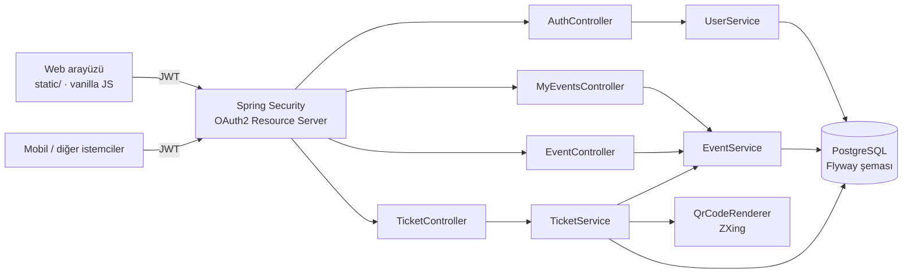
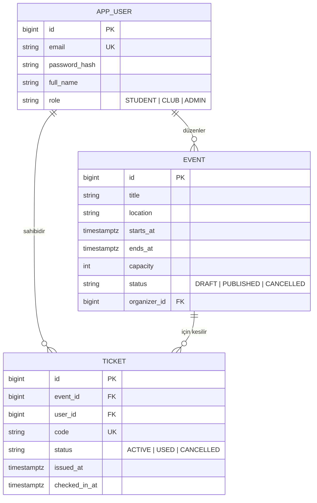

# Kampüs Etkinlik & Bilet API

Üniversite kulüplerinin etkinlik yayınladığı, öğrencilerin kontenjanlı etkinliklere kayıt olup QR kodlu bilet aldığı ve kapıda biletin okutularak giriş yapıldığı bir REST API.

**Teknolojiler:** Java 21 · Spring Boot 3.5 · Spring Security (JWT) · PostgreSQL 16 · Flyway · Testcontainers · Docker · GitHub Actions

## Çözdüğü problem

Kulüp etkinliklerinde kayıtlar genelde bir Google Form ile toplanıyor. Bunun sonucunda:

- kontenjan aşılıyor (form "dolu" olduğunu bilmiyor),
- aynı kişi birden fazla kayıt oluyor,
- kapıda isim listesinden elle kontrol yapılıyor, sahte/başkasına ait kayıtlar ayırt edilemiyor.

Bu API kontenjanı veritabanı seviyesinde garanti ediyor, her öğrenciye tahmin edilemez kodlu tek bir bilet veriyor ve kapıda biletin yalnızca bir kez kullanılabilmesini sağlıyor.

## Mimari





## Özellikler

| Rol | Yapabildikleri |
|---|---|
| Ziyaretçi | Yayınlanmış etkinlikleri listeleme ve detay görme (kalan kontenjanla birlikte), kayıt olma, giriş |
| Öğrenci (`STUDENT`) | Etkinliğe kayıt olup bilet alma, biletlerini listeleme, bileti iptal etme, biletin QR kodunu PNG olarak alma |
| Kulüp (`CLUB`) | Taslak etkinlik oluşturma, güncelleme, yayınlama, iptal etme; kapıda bilet okutma; kayıt/giriş istatistikleri |
| Admin (`ADMIN`) | Kulübün yapabildiği her şey (tüm etkinlikler için) + kullanıcı rolü değiştirme |

### Web arayüzü

Uygulama açıldığında <http://localhost:8080> adresinde Türkçe bir web arayüzü gelir. Ek bir kurulum gerektirmez; Spring Boot `src/main/resources/static/` klasöründeki dosyaları aynı sunucudan sunar.

| Ekran | Kim görür | Ne yapar |
|---|---|---|
| Giriş / Kayıt | Herkes | Hesap açma ve giriş |
| Etkinlikler | Herkes | Yaklaşan etkinlikler, boş yer çubuğu, **Bilet Al** |
| Biletlerim | Öğrenci | Biletin QR kodu, bilet iptali |
| Etkinliklerim | Kulüp/Admin | Etkinlik oluşturma, düzenleme, yayınlama, iptal, istatistik |
| Kapı Girişi | Kulüp/Admin | Kamerayla QR okutma (tarayıcı destekliyorsa), USB okuyucu veya elle kod girişi |
| Kullanıcılar | Admin | Kullanıcı listesi ve rol değiştirme |

Arayüz çerçevesiz, düz JavaScript ile yazıldı. Sunucudan gelen veri sayfaya yalnızca `textContent` ile yazılıyor, böylece etkinlik başlığı gibi alanlardan XSS yapılamıyor. Token `sessionStorage` içinde tutuluyor, sekme kapanınca siliniyor.

### Uç noktalar

| Metot | Yol | Yetki |
|---|---|---|
| POST | `/api/auth/register` | Herkes |
| POST | `/api/auth/login` | Herkes |
| GET | `/api/me` | Giriş yapmış |
| GET | `/api/admin/users` | Admin |
| PATCH | `/api/admin/users/{id}/role` | Admin |
| GET | `/api/events` · `/api/events/{id}` | Herkes |
| POST | `/api/events` | Kulüp/Admin |
| PUT | `/api/events/{id}` | Etkinliğin sahibi/Admin |
| POST | `/api/events/{id}/publish` · `/cancel` | Etkinliğin sahibi/Admin |
| GET | `/api/events/{id}/stats` | Etkinliğin sahibi/Admin |
| POST | `/api/events/{id}/tickets` | Öğrenci |
| GET | `/api/me/tickets` | Giriş yapmış |
| GET | `/api/me/events` | Kulüp/Admin (kendi etkinlikleri, taslaklar dahil) |
| DELETE | `/api/tickets/{id}` | Biletin sahibi |
| GET | `/api/tickets/{id}/qr` | Biletin sahibi |
| POST | `/api/events/{id}/check-in` | Etkinliğin sahibi/Admin |

Uygulama çalışırken tüm uçların ayrıntılı dokümanı: <http://localhost:8080/swagger-ui.html>

## Kurulum

### Docker ile (önerilen)

```bash
cp .env.example .env        # JWT_SECRET ve ADMIN_PASSWORD değerlerini doldurun
docker compose up --build
```

API `http://localhost:8080` adresinde açılır. `.env` dosyasındaki `ADMIN_EMAIL`/`ADMIN_PASSWORD` ile ilk açılışta bir admin hesabı oluşturulur.

### Yerel geliştirme

Java 21 ve çalışan bir PostgreSQL gerekir.

```bash
export JWT_SECRET="$(openssl rand -base64 48)"
export ADMIN_EMAIL=admin@kampus.local ADMIN_PASSWORD='Guclu-Bir-Sifre-1'
./mvnw spring-boot:run
```

### Testler

```bash
./mvnw test      # birim testleri (Docker gerekmez)
./mvnw verify    # + Testcontainers ile gerçek PostgreSQL üzerinde entegrasyon testleri, biçim kontrolü ve kapsam raporu
```

Kapsam raporu: `target/site/jacoco/index.html`

## Örnek akış (curl)

```bash
API=http://localhost:8080

# Admin girişi
ADMIN=$(curl -s $API/api/auth/login -H 'Content-Type: application/json' \
  -d '{"email":"admin@kampus.local","password":"Guclu-Bir-Sifre-1"}' | jq -r .accessToken)

# Kulüp hesabı aç ve rolünü CLUB yap
KULUP_ID=$(curl -s $API/api/auth/register -H 'Content-Type: application/json' \
  -d '{"email":"bilisim@kampus.local","password":"Kulup-Sifre-1","fullName":"Bilişim Kulübü"}' | jq .id)
curl -s -X PATCH $API/api/admin/users/$KULUP_ID/role -H "Authorization: Bearer $ADMIN" \
  -H 'Content-Type: application/json' -d '{"role":"CLUB"}'
KULUP=$(curl -s $API/api/auth/login -H 'Content-Type: application/json' \
  -d '{"email":"bilisim@kampus.local","password":"Kulup-Sifre-1"}' | jq -r .accessToken)

# Etkinlik oluştur ve yayınla
ETK=$(curl -s $API/api/events -H "Authorization: Bearer $KULUP" -H 'Content-Type: application/json' \
  -d '{"title":"Spring Boot Atölyesi","location":"Amfi 2","startsAt":"2027-03-10T14:00:00Z","endsAt":"2027-03-10T17:00:00Z","capacity":40}' | jq .id)
curl -s -X POST $API/api/events/$ETK/publish -H "Authorization: Bearer $KULUP"

# Öğrenci kayıt olur ve bilet alır
curl -s $API/api/auth/register -H 'Content-Type: application/json' \
  -d '{"email":"ayse@kampus.local","password":"Ogrenci-Sifre-1","fullName":"Ayşe Yılmaz"}'
OGR=$(curl -s $API/api/auth/login -H 'Content-Type: application/json' \
  -d '{"email":"ayse@kampus.local","password":"Ogrenci-Sifre-1"}' | jq -r .accessToken)
BILET=$(curl -s -X POST $API/api/events/$ETK/tickets -H "Authorization: Bearer $OGR")
curl -s $API/api/tickets/$(echo $BILET | jq .id)/qr -H "Authorization: Bearer $OGR" -o bilet.png

# Kapıda okutma (ikinci okutma 409 döner)
curl -s $API/api/events/$ETK/check-in -H "Authorization: Bearer $KULUP" \
  -H 'Content-Type: application/json' -d "{\"code\":\"$(echo $BILET | jq -r .code)\"}"
```

Hatalar [RFC 9457 Problem Details](https://www.rfc-editor.org/rfc/rfc9457) biçiminde döner:

```json
{ "status": 409, "title": "Conflict", "detail": "Etkinlik kontenjanı dolu" }
```

## Tasarım kararları

- **Kontenjan yarış durumu (race condition):** Aynı anda gelen kayıt istekleri kontenjanı aşmasın diye kayıt sırasında etkinlik satırı `SELECT ... FOR UPDATE` ile kilitleniyor. Aynı etkinliğe gelen kayıtlar sıraya giriyor, farklı etkinlikler birbirini beklemiyor. Bu davranış 20 eş zamanlı istekle 5 kişilik etkinliğe kayıt deneyen bir entegrasyon testiyle doğrulanıyor.
- **Tek kişi tek bilet:** Uygulama kontrolüne ek olarak veritabanında kısmi benzersiz indeks var: `(event_id, user_id) WHERE status <> 'CANCELLED'`. İptal edilen bilet engel olmuyor, ama iki canlı bilet hiçbir koşulda oluşamıyor.
- **Çift okutma:** Kapıda bilet satırı da kilitlenerek okunuyor. Aynı bilet iki turnikede aynı anda okutulsa bile yalnızca biri başarılı oluyor.
- **Tahmin edilemez bilet kodu:** Kodlar `SecureRandom` ile üretilen 32 baytlık base64url dizeleri; sıralı ID'ler QR'a hiç konmuyor.
- **Bilgi sızdırmama:** Başkasının biletine erişim `403` yerine `404` döndürüyor, böylece bilet ID'lerinin var olup olmadığı anlaşılamıyor. Giriş hatasında da e-postanın kayıtlı olup olmadığı belli edilmiyor.
- **Varsayılan admin şifresi yok:** Admin hesabı yalnızca ortam değişkenleri verilirse oluşturuluyor; kodda gömülü bir şifre bulunmuyor. Kayıt ucu her zaman `STUDENT` rolü veriyor.
- **Rol değişikliği:** Roller JWT içinde taşındığı için rol değişikliği kullanıcı yeniden giriş yaptığında geçerli oluyor (kısa ömürlü token: varsayılan 2 saat).
- **Şema yönetimi:** Şema yalnızca Flyway ile değişiyor; Hibernate `validate` modunda, yani kod ile şema uyuşmazsa uygulama hiç açılmıyor.
- **Testler gerçek veritabanında:** Entegrasyon testleri H2 yerine Testcontainers ile gerçek PostgreSQL 16 üzerinde koşuyor; kilitler ve kısmi indeks gibi PostgreSQL'e özgü davranışlar böylece gerçekten test ediliyor.

## Geliştirilebilecekler

- Refresh token ve token iptali (çıkış yapınca token'ın geçersiz olması)
- Kontenjan dolunca bekleme listesi; bir bilet iptal edilince sıradakine otomatik bilet
- Etkinlik öncesi e-posta hatırlatması (zamanlanmış iş)
- Kapı görevlisi için ayrı, yalnızca okutma yetkisi olan bir rol
- Oran sınırlama (rate limiting) ve denetim kaydı (audit log)
